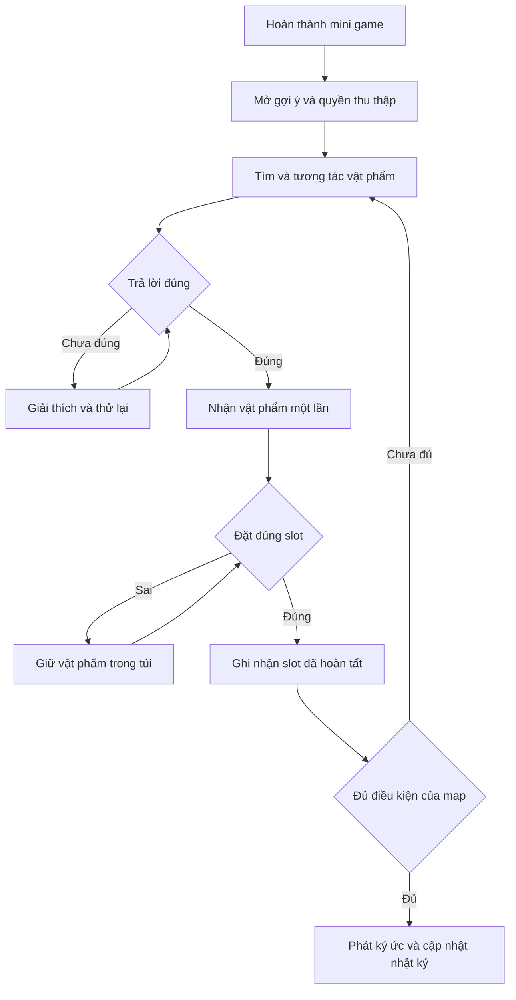
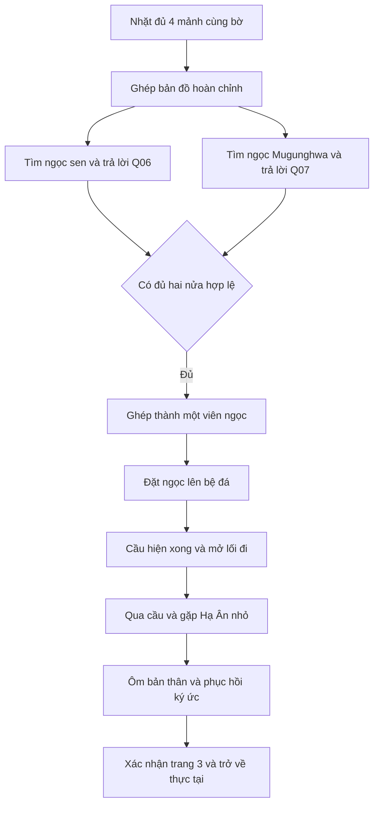

# Workflow logic các map Journey of Memories

**Chuyến đi của những ký ức**  
Phiên bản workflow 1.0 · Ngày 14 tháng 10 năm 2026  
Dành cho nhóm thiết kế và lập trình game

Hạ Ân khôi phục cuốn nhật ký qua ba không gian ký ức theo thứ tự: căn bếp, phòng thay đồ và khu vườn. Mỗi map phải hoàn tất thử thách riêng, thu thập đúng vật phẩm và giải quyết điểm nút cảm xúc trước khi mở map tiếp theo. Tài liệu này mô tả hành động của người chơi, phản hồi của game, điều kiện chuyển bước và cách khôi phục khi thao tác bị gián đoạn.

**Phạm vi:** ba map gameplay, cảnh mở đầu, cảnh kết, bảy câu hỏi văn hóa, inventory, gợi ý và lưu tiến trình. Gameplay chính chạy offline; không cần API Internet. Các tên trạng thái và ID dưới đây là quy ước đề xuất để nhóm thống nhất khi triển khai.

## 1 Cấu trúc hành trình và cấu hình đề xuất

### 1A Mạch truyện xuyên suốt

| Chặng | Việc Hạ Ân thực hiện | Thay đổi về nhận thức | Kết quả mở đường |
| --- | --- | --- | --- |
| Mở đầu | Mở hộp thời gian và đọc nhật ký trắng | Nhận ra khoảng trống trong ký ức của mình | Bước vào căn bếp ký ức |
| Map 1 Căn bếp | Tái hiện mâm cơm ba món | Khác biệt có thể cùng tồn tại trong sự chăm sóc | Trang nhật ký bữa cơm được phục hồi |
| Map 2 Phòng thay đồ | Làm rõ ảnh gia đình và tái hiện hai bộ trang phục | Cội nguồn là điều để tự hào, không phải khuôn mẫu ép buộc | Trang nhật ký trang phục được phục hồi |
| Map 3 Khu vườn | Ghép bản đồ, ghép ngọc, qua cầu và ôm bản thân lúc nhỏ | Chấp nhận mình thuộc về cả hai cội nguồn | Ký ức cuối được phục hồi và trở về thực tại |
| Cảnh kết | Viết trang cuối rồi rời nhà vào ban mai | Tự định nghĩa bản thân | Hoàn thành trò chơi |

Hoàng hôn thể hiện ký ức đang khép lại bằng ánh sáng, âm thanh và lời thoại. **Không dùng đồng hồ đếm ngược làm người chơi thua hoặc mất tiến trình.** Thời gian trong ký ức được cách điệu; cảnh ban mai xuất hiện khi trở về thực tại. Không cần giải thích hành trình bằng số giờ chơi thực tế.

### 1B Cấu hình để nhóm triển khai thống nhất

Các mục trong bảng này là **phương án thiết kế đề xuất cho workflow**, gồm những chi tiết cơ chế mà nhóm cần thống nhất khi tích hợp. Có thể chỉnh tham số sau khi chơi thử nhưng phải giữ các quan hệ điều kiện trong tài liệu.

| Hạng mục | Phương án đề xuất |
| --- | --- |
| Thứ tự map | Tuyến tính Map 1 → Map 2 → Map 3; không quay về map trước trong lượt chơi hiện tại |
| Khám phá trong map | Sau khi mở gợi ý, được tìm và đặt từng vật phẩm theo bất kỳ thứ tự nào |
| Vật phẩm trước mini game | Chỉ quan sát được; chưa mở câu hỏi và chưa thu thập được |
| Inventory | 5 ô; đặt đúng thì chuyển vật phẩm khỏi túi sang slot; đặt sai giữ nguyên |
| Mảnh bản đồ | 4 mảnh, nằm cùng bờ xuất phát; lưu trong bộ đếm nhiệm vụ riêng, không chiếm ô túi và không có quiz |
| Mini game mèo | Hoàn thành 3 lượt vuốt hợp lệ; không tính theo số khung hình chạm |
| Mini game lau ảnh | Lau ít nhất 90% lớp bụi toàn ảnh và 90% tại mỗi vùng trang phục của bố, mẹ |
| Ghép bản đồ | Khớp đúng 4 mảnh; hướng mảnh cố định, không có thao tác xoay |
| Ghép ngọc | Thao tác thủ công trong UI; hai nửa đổi thành một viên ngọc hoàn chỉnh |
| Lưu game | Tự lưu sau mỗi thay đổi tiến độ đã xác nhận; hỗ trợ tiếp tục sau khi đóng ứng dụng |
| Cảnh ký ức | Phát trong map bằng lớp trình bày riêng; nhật ký tiếp nối sau cảnh ký ức |
| Điều khiển | Chơi được bằng joystick, nút tương tác và chạm màn hình; không bắt buộc gõ chữ |

**Ngoại lệ có chủ đích:** bảy vật phẩm văn hóa cần câu hỏi; mảnh bản đồ là thành phần của mini game; viên ngọc hoàn chỉnh là kết quả ghép. Không tạo thêm câu hỏi cho mảnh bản đồ hoặc viên ngọc đã ghép.

## 2 Quy tắc vận hành dùng chung

### 2A Điều kiện tương tác và quyền điều khiển

1. Chỉ tương tác khi nhân vật ở trong phạm vi đối tượng, không bị tường chắn và map cho phép hành động đó. Nếu nhiều đối tượng cùng gần, nút tương tác phải hiển thị rõ đối tượng đang được chọn.
2. Khi mở quiz, mini game, nhật ký, pause hoặc cảnh ký ức, khóa di chuyển và tương tác thế giới. Người chơi vẫn sử dụng được UI đang mở.
3. Chỉ có một UI chính nhận thao tác tại một thời điểm. Pause có thể phủ lên UI hiện tại; khi tiếp tục, trở về đúng UI đó, không mở khóa thế giới sớm.
4. Đóng quiz chưa trả lời đúng không tạo phần thưởng. Đóng mini game chưa đạt điều kiện không mở gợi ý.
5. Tương tác vật phẩm trước khi mở gợi ý chỉ hiện mô tả trung tính và nhắc nhiệm vụ mini game. Không hiện đáp án hoặc tự mở vị trí cất đồ.

### 2B Cách chơi không ép thứ tự vô lý

Map 1 không bắt buộc tìm thịt kho trước kim chi; Map 2 không bắt buộc lấy áo dài trước Hanbok; Map 3 không bắt buộc lấy ngọc sen trước ngọc Mugunghwa. Người chơi được thu thập một món rồi đặt ngay, hoặc thu thập đủ rồi đặt. Mỗi slot vẫn chỉ nhận đúng vật phẩm của nó.

“Đặt đúng chỗ” là khôi phục cách sắp xếp trong ký ức gia đình này. Đây không phải quy định rằng mọi gia đình phải đặt món ăn hoặc trang phục theo một trật tự văn hóa cố định. Manh mối bằng hình dáng, ảnh tham chiếu hoặc dấu vết phải xuất hiện trước thao tác đặt.

### 2C Tách tiến độ bền vững khỏi trạng thái UI

**Trạng thái map:** `NotStarted → Active → MemoryPending → JournalPending → Completed`. Map 3 có thêm các mốc mở cầu và cuộc gặp trước `MemoryPending`.

**Trạng thái UI:** khám phá, quiz, mini game, pause, cảnh ký ức, nhật ký hoặc chuyển cảnh. UI thay đổi tạm thời; đóng UI không được xóa tiến độ.

Không dùng một trạng thái tuần tự kiểu “đang thu thập” để cấm đặt đồ khi chưa nhặt đủ. Các cờ mini game, vật phẩm và slot được kiểm tra độc lập. `Completed` chỉ được đặt sau khi cảnh ký ức đã kết thúc và người chơi xác nhận trang nhật ký.

### 2D Vòng lặp của một vật phẩm văn hóa

Áp dụng trực tiếp cho Map 1 và Map 2. Map 3 thay bước đặt riêng từng vật phẩm bằng ghép hai nửa ngọc, đặt ngọc lên bệ, qua cầu và gặp Hạ Ân nhỏ.

## 3 Cảnh mở đầu tại ngôi nhà cũ

### 3A Khởi tạo lượt chơi

**Điểm vào:** người chơi chọn “Bắt đầu mới”. Nếu đang có lượt chơi, chỉ xóa dữ liệu sau khi người chơi xác nhận. “Tiếp tục” đọc trạng thái đã lưu và đi đến đúng chặng, không phát mở đầu lại.

**Bố trí:** Hạ Ân đứng gần hộp thời gian trong nhà. Hộp là điểm tương tác chính. Chưa mở đường đến phòng thay đồ hoặc khu vườn.

### 3B Luồng thực hiện

1. Hiện mục tiêu “Mở chiếc hộp đã hẹn cùng ba mẹ”. Dạy di chuyển và nút tương tác bằng thao tác trực tiếp.
2. Người chơi mở hộp. Khóa điều khiển; hiện cuốn nhật ký trắng. Nhắc tuổi 20 và lời hứa từ 12 năm trước để nối với Hạ Ân 8 tuổi ở cuối game.
3. Người chơi chạm “Mở nhật ký”. Hạ Ân nhận ra ký ức trống vắng; ánh sáng chuyển sang hoàng hôn.
4. Âm thanh bát đũa hoặc mùi món ăn gợi nhớ căn bếp. Đây là cách dẫn cảnh đề xuất, không phải một câu đố mới.
5. Người chơi chạm “Theo dấu ký ức”. Ghi `introSeen = true`, đặt chặng hiện tại là Map 1 rồi lưu trước khi chuyển cảnh.
6. Map 1 tải thành công, Hạ Ân xuất hiện tại cửa bếp. Chỉ lúc này mới mở lại điều khiển.

**Khi gián đoạn:** nếu thoát trước bước 5, phát lại mở đầu từ mốc đầu cảnh; nếu đã xác nhận bước 5, tiếp tục ở Map 1. Không tạo hai cuốn nhật ký trong inventory. Nhật ký là chức năng riêng của game.

## 4 Map 1 Căn bếp gia đình

### 4A Mục tiêu và bố trí

**Mục tiêu hiện trên màn hình:** “Khôi phục mâm cơm của gia đình”.

**Điều kiện vào:** `introSeen = true`. Map 1 đang hoạt động; mèo chưa được vuốt đủ; ba món chưa được thu thập; ba slot còn trống. Inventory trống ở lần vào đầu tiên.

| Khu vực | Đối tượng | Vai trò và khả năng tiếp cận |
| --- | --- | --- |
| Cửa bếp | Điểm xuất hiện | Nhìn được mâm cơm và mèo ngay từ đầu |
| Cạnh bàn ăn | Mèo | Mở mini game; có thể đến gần ngay |
| Góc bếp | Nồi có nắp | Chứa thịt kho trứng; vị trí theo brief |
| Cạnh tủ lạnh | Ngăn mát | Vị trí đề xuất cho hũ kim chi |
| Kệ cạnh bàn | Hộp cơm | Vị trí đề xuất cho kimbap |
| Giữa phòng | Mâm cơm có ba vị trí | Có dấu khớp hình bát, hũ và đĩa; không chặn lối di chuyển |
| Cuối phòng | Cửa phòng thay đồ | Khóa cho đến khi hoàn thành trang nhật ký Map 1 |

### 4B Vuốt ve mèo để mở gợi ý

1. Đến gần mèo và chạm “Vuốt ve”. Mở UI cận cảnh, khóa di chuyển; mục tiêu tạm đổi thành “Làm quen với mèo”.
2. Mỗi lượt vuốt hợp lệ phải bắt đầu trong vùng lưng mèo, di chuyển ít nhất 30% chiều rộng vùng vuốt, phần lớn đường vuốt nằm trong vùng và kết thúc khi nhấc tay. Chạm giữ một chỗ không được tính.
3. Đủ 3 lượt hợp lệ thì mèo thả lỏng và kêu đáp lại. Lượt sai không trừ tiến độ. Các giá trị này là tham số có thể chỉnh sau playtest.
4. Ghi `M1.miniDone = true`, mở đồng thời ba gợi ý; lưu một lần. Mèo hướng mắt hoặc đi một đoạn về phía các khu vực cất đồ, không tự đi nhặt thay người chơi.
5. UI nhiệm vụ chuyển sang “Tìm và bày ba món lên mâm”. Người chơi có thể xem lại gợi ý ở nhật ký nhiệm vụ.

Nếu đóng mini game trước khi xong, giữ số lượt hợp lệ trong phiên chơi. Khi đóng hẳn ứng dụng, phần chưa hoàn thành được làm lại từ đầu; trạng thái đã hoàn thành thì không phải chơi lại. Mèo không di chuyển tới vị trí làm người chơi mất khả năng tương tác.

### 4C Ba nhánh tìm món ăn

| Nhánh | Gợi ý đề xuất | Tương tác và câu hỏi | Vật phẩm nhận | Slot đích |
| --- | --- | --- | --- | --- |
| Món mẹ nấu | “Chiếc nồi có nắp ở góc bếp vẫn đợi cả nhà.” | Mở nắp nồi; Q01 | Thịt kho trứng | `Slot_ThitKhoTrung` |
| Hũ kim chi | “Tìm trong ngăn mát, nơi ba cất hũ thức ăn quen thuộc.” | Mở ngăn mát; Q02 | Kim chi | `Slot_Kimchi` |
| Hộp kimbap | “Hộp cơm trên kệ cạnh bàn vẫn được đậy cẩn thận.” | Mở hộp; Q03 | Kimbap | `Slot_ComCuon` |

Mỗi nhánh đi qua cùng quy trình: tới đúng chỗ → tương tác → trả lời quiz → nhận món vào túi → chọn món → tới mâm → chọn slot. Trả lời sai giữ nguyên món ở nơi cất. Khi trả lời đúng, món vào túi ngay một lần; bảng giải thích còn hiện cho đến khi người chơi chạm “Đóng”.

Nếu đặt sai, hiện “Hãy nhìn dấu khớp của bát, hũ hoặc đĩa trên mâm”; vật phẩm vẫn trong túi. Nếu đúng, vật phẩm xuất hiện trên mâm, biến mất khỏi túi và slot được ghi nhận. Người chơi luôn nhìn thấy tiến độ “Đã bày 0/3, 1/3, 2/3, 3/3 món”.

### 4D Điều kiện hoàn thành và chuyển map

Đủ điều kiện phát ký ức khi **mèo đã hoàn thành mini game, Q01–Q03 đã được trả lời đúng và cả ba slot nhận đúng vật phẩm**. Không dùng riêng biến đếm 3 để kết luận hoàn thành.

1. Lần đặt đúng cuối cùng cập nhật dữ liệu, lưu `MemoryPending`, rồi khóa tương tác. Nếu UI đặt đồ vẫn mở, đóng nó trước khi phát ký ức.
2. Hiện mâm cơm có đầy đủ thịt kho trứng, kimbap và kim chi. Cảnh ký ức thể hiện ba mẹ nhường nhau, cùng chăm chút bữa ăn; không có món nào “thắng” món nào.
3. Kết thúc cảnh, đánh dấu ký ức đã xem và mở trang nhật ký thứ nhất. Nội dung đề xuất: “Mâm cơm của nhà mình đủ chỗ cho những điều khác nhau.”
4. Người chơi chạm “Ghi nhớ”. Ghi trang 1 đã xác nhận, đánh dấu Map 1 `Completed`, mở cửa phòng thay đồ và lưu.
5. Mục tiêu đổi thành “Đi tới phòng thay đồ”. Người chơi đến cửa, chạm “Sang phòng thay đồ”; lưu chặng Map 2 rồi chuyển cảnh.

**Cửa bị khóa:** nếu chạm cửa sớm, chỉ nhắc bước đang thiếu như “Hãy bày đủ món lên mâm” hoặc “Hãy đọc trang ký ức vừa hiện ra”. Không tải Map 2.

## 5 Map 2 Phòng thay đồ

### 5A Mục tiêu và bố trí

**Mục tiêu:** “Tái hiện trang phục trong bức ảnh gia đình”. **Điều kiện vào:** Map 1 đã hoàn thành và trang nhật ký thứ nhất đã xác nhận.

| Khu vực | Đối tượng | Chức năng |
| --- | --- | --- |
| Gần cửa vào | Kệ có ảnh phủ bụi | Điểm bắt đầu mini game; nhìn thấy được từ lối vào |
| Một bên phòng | Tủ hoặc hộp vải có họa tiết tương ứng trong ảnh | Chứa áo dài của mẹ; vị trí đề xuất |
| Bên còn lại | Tủ hoặc hộp vải có dấu tương ứng trong ảnh | Chứa Hanbok của bố; vị trí đề xuất |
| Giữa phòng | Hai ma nơ canh | Tái hiện vị trí bố và mẹ trong ảnh |
| Cuối phòng | Cửa ra vườn | Chỉ mở sau khi xác nhận trang nhật ký thứ hai |

Ảnh sạch phải cho thấy **bố mặc Hanbok, mẹ mặc áo dài**. Đặt hai ma nơ canh tương ứng với bố và mẹ trong ảnh; giữ ảnh thu nhỏ trên UI đặt đồ để người chơi có căn cứ. Vị trí đúng là tái hiện tấm ảnh này, không phải quy tắc về ai được phép mặc trang phục nào.

### 5B Lau bụi và nhận manh mối

1. Tương tác ảnh để mở mini game. Người chơi kéo ngón tay hoặc chuột trên lớp bụi; khu vực đã lau không tăng tiến độ thêm khi lau lặp.
2. Chỉ tính trên vùng ảnh có lớp bụi, không tính khung tranh hay phần nền ngoài ảnh. Tỉ lệ hoàn thành lấy từ vùng bụi đã xóa thực sự.
3. Đạt ít nhất 90% toàn ảnh **và** 90% ở từng vùng trang phục của bố, mẹ thì xác nhận hoàn thành. Quy tắc vùng quan trọng ngăn người chơi bỏ lại đúng chi tiết cần quan sát.
4. Game xóa phần bụi nhỏ còn lại, ghi `M2.miniDone = true`, mở gợi ý hai trang phục và lưu. Bức ảnh giữ trạng thái sạch khi tải lại game.
5. Hiện lời nhắc “Hãy tìm hai bộ đồ trong ảnh và tái hiện chúng trên ma nơ canh”. Người chơi có thể mở lại ảnh bất kỳ lúc nào trong Map 2.

Chưa đủ điều kiện thì ảnh chưa được tính hoàn thành, dù người chơi đã mở hoặc đóng UI. Lớp bụi đang lau dở được giữ trong phiên; đóng ứng dụng thì làm lại phần chưa hoàn thành. Không có đồng hồ hoặc phạt khi lau ra ngoài vùng ảnh.

### 5C Hai nhánh tìm trang phục

| Vật phẩm | Manh mối và hành động | Câu hỏi | Đích đến |
| --- | --- | --- | --- |
| Áo dài | Từ chi tiết màu hoặc họa tiết trong ảnh, tìm đúng tủ hoặc hộp; mở để quan sát | Q04 | Ma nơ canh tái hiện mẹ |
| Hanbok nam | Từ dấu nhận diện trong ảnh, tìm vị trí cất bộ đồ của bố; mở để quan sát | Q05 | Ma nơ canh tái hiện bố |

Sau khi trả lời đúng, bộ trang phục vào túi. Đến gần ma nơ canh, chọn vật phẩm và chạm đặt. Sai vị trí thì trả lại vật phẩm vào trạng thái đang chọn; không tăng tiến độ. Phản hồi đề xuất: “Vị trí này chưa khớp với tấm ảnh. Mình xem lại ảnh nhé.”

Không yêu cầu đổi trang phục cho nhân vật chính và không thêm thao tác may, sửa đồ. Mỗi bộ là một vật phẩm hoàn chỉnh để giữ phạm vi gameplay tập trung.

### 5D Hoàn thành ký ức và ra vườn

Điều kiện phát ký ức: `M2.miniDone`, Q04 và Q05 đã đúng, áo dài ở slot của mẹ, Hanbok ở slot của bố.

1. Hai ma nơ canh hoàn tất thì lưu `MemoryPending` và phát ký ức. Hình ảnh cha mẹ trong ảnh được nối với cách gia đình giữ gìn cả hai cội nguồn.
2. Lời thoại đề xuất: “Những bộ đồ này mang câu chuyện của ba mẹ. Con không phải mặc vừa kỳ vọng của mọi người mới có quyền tự hào về mình.”
3. Ký ức kết thúc, mở trang nhật ký thứ hai. Nội dung đề xuất: “Cội nguồn là món quà mình có thể mang theo bằng cách của mình.”
4. Người chơi chạm “Ghi nhớ”; Map 2 `Completed`, trang 2 được xác nhận, cửa vườn mở và tiến độ được lưu.
5. Đến cửa và chạm “Ra khu vườn”. Lưu chặng Map 3, chuyển cảnh đến bờ xuất phát của vườn.

## 6 Map 3 Khu vườn lúc hoàng hôn

### 6A Sơ đồ phụ thuộc của map cuối

### 6B Mục tiêu và nguyên tắc bố trí

**Mục tiêu đầu map:** “Tìm cách đi sang bờ bên kia”. **Điều kiện vào:** Map 2 hoàn thành và trang nhật ký thứ hai đã xác nhận.

Bờ xuất phát chứa toàn bộ vật cần để mở cầu: bốn mảnh bản đồ, hai nửa ngọc và bệ đá. Bờ đối diện chỉ chứa Hạ Ân lúc 8 tuổi và điểm kích hoạt cuộc gặp. **Không đặt bất kỳ vật phẩm mở cầu nào ở bờ bên kia.**

| Khu vực | Bố trí đề xuất | Vai trò |
| --- | --- | --- |
| Đầu lối đi | Mảnh bản đồ 1 ngay gần chân nhân vật | Dạy nhặt mảnh; cho thấy đây là nhiệm vụ mới |
| Quanh bờ xuất phát | Mảnh 2 cạnh ghế, mảnh 3 gần gốc cây, mảnh 4 cạnh lối hoa | Đều đi tới được khi chưa có cầu |
| Gần lối cầu | Bệ đá có hốc ngọc | Cho thấy cần viên ngọc nguyên vẹn |
| Cạnh cụm sen | Hốc cất nửa ngọc sen | Chỉ mở tương tác thu thập sau khi bản đồ hoàn chỉnh |
| Cạnh bụi Mugunghwa | Hốc cất nửa ngọc Mugunghwa | Cùng bờ với Hạ Ân, không bị khóa bởi vật phẩm khác |
| Khoảng nước | Cây cầu chưa xuất hiện | Collider chặn lối và mép nước; không thể đi vòng qua |
| Bờ đối diện | Hạ Ân 8 tuổi | Nhìn thấy từ xa nhưng chưa tương tác được |

### 6C Nhặt và ghép bản đồ

1. Nhặt mảnh đầu dưới chân. Hiện mục tiêu “Thu thập mảnh bản đồ 1/4” và các vị trí tìm kiếm gần đó bằng bố cục cảnh, không tiết lộ vị trí ngọc.
2. Mỗi mảnh có ID riêng. Nhặt một mảnh thì thêm ID vào tập mảnh đã có và ẩn đúng mảnh đó trong cảnh. Không mở quiz; không dùng một ô inventory.
3. Chưa đủ bốn mảnh thì nút “Ghép bản đồ” bị khóa, kèm số mảnh còn thiếu. Không được để mảnh thứ tư nằm trong khu vực cần bản đồ để mở.
4. Đủ bốn mảnh thì nút “Ghép bản đồ” sáng. Người chơi chủ động mở UI để chơi; không bắt đầu cưỡng bức giữa lúc đang di chuyển.
5. Kéo hoặc chọn mảnh rồi chạm ô đích. Mảnh chỉ bám vào đúng ô của nó; sai thì về khay. Khung bản đồ có đường sông, bờ đá và lối đi liên tục để suy luận.
6. Mỗi mảnh đúng được lưu một lần. Chỉ đủ bốn ID đúng ô mới ghi `M3.miniDone = true`; không dựa vào số lần thả.
7. Bản đồ hiện hai dấu vị trí ngọc và biểu tượng hốc ngọc trên bệ. Mục tiêu đổi thành “Tìm hai nửa ngọc 0/2”. Có nút mở lại bản đồ đã ghép.

Các mảnh đã nhặt và đã đặt đúng được lưu khi hoàn tất từng thao tác. Khi tải lại, mảnh đang kéo trở về khay; mảnh đã khớp vẫn nằm trong ô. Bản đồ hoàn chỉnh là trang nhiệm vụ, không thành vật phẩm trong túi.

### 6D Tìm hai nửa ngọc

Hai nhánh mở đồng thời sau khi ghép bản đồ. Nửa sen gắn Q06; nửa Mugunghwa gắn Q07. Mỗi câu đúng cấp đúng một nửa ngọc vào inventory. Người chơi không bị ép lấy một bên trước.

Nếu đến hốc cất ngọc trước khi ghép xong bản đồ, hiện “Những nét khắc còn thiếu dấu chỉ dẫn”; không mở quiz. Đây là khóa theo hiểu biết của nhân vật trong không gian ký ức, không cần thêm chìa khóa vật lý.

**Gợi ý hai cấp:** đầu tiên chỉ khu vực trên bản đồ; khi người chơi chạm “Gợi ý rõ hơn”, mô tả vật thể gần đó. Cấp hai chỉ mở sau cùng điều kiện mini game. Không tự chọn đáp án hoặc tự cấp ngọc.

### 6E Ghép ngọc nguyên vẹn

1. Có đủ hai nửa trong túi thì bật nút “Ghép ngọc”. Có một nửa thì hiện “Cần tìm nửa còn lại”.
2. Mở UI có đường ghép và hai phần họa tiết. Người chơi đặt mỗi nửa vào vùng tương ứng; hướng cố định, không tạo thêm câu đố xoay hình phức tạp.
3. Các nửa đặt trong UI mới là bản xem trước. **Chưa xóa hai vật phẩm thật khỏi inventory.** Đóng UI hoặc thoát lúc này vẫn giữ cả hai nửa.
4. Đủ hai nửa khớp đúng thì nút “Ghép lại” được bật. Khi chạm, hệ thống kiểm tra lại cả hai vật phẩm còn trong túi và cả Q06, Q07 đã đúng.
5. Trong cùng một thao tác dữ liệu, chuyển hai nửa sang trạng thái đã dùng để ghép và thêm một `Gem_Whole` vào túi. Nếu không thể hoàn tất toàn bộ, hủy thao tác và giữ hai nửa.
6. Lưu trạng thái; UI hiển thị một viên ngọc hoàn chỉnh, số ô chiếm giảm từ hai xuống một. Không đặt điều kiện phải có ô trống thứ ba trước khi ghép.

### 6F Đặt ngọc và tạo cầu

1. Người chơi đến bệ đá, chọn viên ngọc hoàn chỉnh và chạm “Đặt ngọc”. Bệ chỉ nhận `Gem_Whole`.
2. Nếu chọn một nửa ngọc, thông báo “Hốc đá cần viên ngọc nguyên vẹn”; vật phẩm không mất. Nếu chọn sai vật khác, không tăng tiến độ.
3. Đặt đúng thì chuyển viên ngọc từ túi sang `Slot_Pedestal`, lưu `pedestalPlaced = true` và khóa điều khiển cho hiệu ứng cầu.
4. Cầu xuất hiện hoàn toàn rồi mới mở collider cho đi qua và ghi `bridgeReady = true`. Không cho nhân vật đi lên vùng cầu chưa dựng xong.
5. Mở điều khiển, đổi mục tiêu thành “Đi qua cầu, gặp cô bé”. Ngọc giữ nguyên trên bệ; không cần lấy lại và không cần trả lời thêm câu hỏi.

Nếu ứng dụng đóng trong lúc cầu xuất hiện, tải lại từ dữ liệu ngọc đã đặt và dựng cầu ở trạng thái hoàn chỉnh. Không phát lại thao tác tiêu thụ ngọc. Nếu hiệu ứng không kết thúc như dự kiến, bộ điều phối vẫn phải có nhánh hoàn tất cầu và mở điều khiển sau thời lượng cấu hình.

### 6G Gặp Hạ Ân lúc 8 tuổi

1. Người chơi đi qua cầu. Chỉ vào vùng gặp sau cầu và có `bridgeReady = true` mới mở lời nhắc tương tác với cô bé.
2. Chạm “Đến gần”. Khóa điều khiển, lưu `reunionPending = true`, bắt đầu cảnh đối thoại và cái ôm.
3. Cô bé gợi lại nỗi sợ không thuộc về đâu; Hạ Ân trưởng thành đón nhận cả hai cội nguồn. Không chèn câu trắc nghiệm hoặc lựa chọn “bỏ một phía” tại cao trào này.
4. Cảnh ôm kết thúc mới ghi `reunionSeen = true`. Ánh sáng trên cầu và hai họa tiết ngọc hòa hợp hơn; **cầu đã xuất hiện ở bước đặt ngọc, không tạo cây cầu thứ hai**.
5. Hiện trang nhật ký thứ ba. Nội dung đề xuất: “Mình có thể là nhịp cầu mà vẫn trọn vẹn là chính mình.” Người chơi chạm “Trở về thực tại”.
6. Ghi trang 3 đã xác nhận và Map 3 `Completed`; lưu chặng Ending trước khi chuyển cảnh.

Tạo cầu không đồng nghĩa hoàn thành map. Map 3 chỉ hoàn thành khi đã gặp, ôm Hạ Ân nhỏ, xem xong ký ức và xác nhận trang nhật ký.

## 7 Cảnh kết và điều kiện kết thúc trò chơi

### 7A Trở về hiện tại

Điều kiện vào Ending: cả ba map hoàn thành, ba trang nhật ký được xác nhận và `reunionSeen = true`. Cảnh mở ở vị trí chiếc hộp thời gian trong nhà; nhật ký đã có màu sắc. Trang cuối vẫn trắng.

**Câu hỏi từ ba mẹ, lời thoại đề xuất:** “Nếu không phải chọn chỉ một phía, con muốn kể mình là ai?” Người chơi chạm “Viết trang cuối” để Hạ Ân bắt đầu viết. Không bắt buộc nhập văn bản hoặc kết nối Internet.

### 7B Trang viết cuối giữ nguyên cốt truyện

> Nhiều năm qua, con đã luôn hoang mang vì nghĩ mình là một mảnh ghép lỗi, không vừa vặn với bức tranh của bất kỳ ai. Nhưng khi đi lại những bước chân này, con đã hiểu. Một trái tim không cần chia đôi để thuộc về hai quê hương. Con không phải là một nửa của nơi này, cộng với một nửa của nơi kia. Con là điểm giao thoa. Con là một nhịp cầu. Cảm ơn ba mẹ đã cho con hai cội nguồn, để thế giới của con rộng lớn gấp đôi.

### 7C Thứ tự các thao tác kết thúc

1. Khi chữ đang xuất hiện, chạm một lần chỉ hiển thị hết đoạn hiện tại. Không đồng thời bỏ qua cả trang hoặc chuyển cảnh.
2. Khi toàn bộ trang cuối đã hiện, nút “Khép nhật ký” mới có hiệu lực. Chạm nút này ghi `finalPageConfirmed = true`.
3. Phát cảnh Hạ Ân khép nhật ký, bước ra khỏi nhà dưới ánh nắng ban mai.
4. Khi cảnh rời nhà kết thúc, ghi `gameCompleted = true`, lưu rồi hiện màn hoàn thành.
5. Màn hoàn thành có “Về menu” và “Xem lại nhật ký”. “Bắt đầu mới” ở menu cần xác nhận trước khi xóa lượt chơi.

Nếu thoát khi trang cuối đang viết, mở lại tại trang cuối và cho viết tiếp hoặc hiện lại toàn đoạn. Nếu đã khép nhật ký nhưng chưa xem xong cảnh rời nhà, phát lại cảnh rời nhà. Không gắn cờ hoàn thành game ngay tại bước mở cầu hoặc bắt đầu Ending.

## 8 Danh mục dữ liệu và điều kiện xác nhận

### 8A Ánh xạ vật phẩm câu hỏi và slot

| Map | ID vật phẩm đề xuất | Quiz | Đáp án | Đích sử dụng |
| --- | --- | --- | --- | --- |
| 1 | `Food_ThitKhoTrung` | Q01 | B | `Slot_ThitKhoTrung` |
| 1 | `Food_Kimchi` | Q02 | C | `Slot_Kimchi` |
| 1 | `Food_ComCuon` | Q03 | B | `Slot_ComCuon` |
| 2 | `Clothing_AoDai` | Q04 | C | `Slot_Mother` |
| 2 | `Clothing_Hanbok` | Q05 | A | `Slot_Father` |
| 3 | `Gem_LotusHalf` | Q06 | B | Công thức `Combine_Gem` |
| 3 | `Gem_MugunghwaHalf` | Q07 | C | Công thức `Combine_Gem` |
| 3 | `Gem_Whole` | Không thêm quiz | Không áp dụng | `Slot_Pedestal` |

`Food_ComCuon` và `Slot_ComCuon` được giữ theo tên đã nêu trong brief. Các ID khác cần đối chiếu project khi tích hợp. Tên hiển thị với người chơi luôn dùng tiếng Việt dễ hiểu; không đưa ID kỹ thuật lên UI.

### 8B Các cổng điều kiện bắt buộc

| Cổng | Tất cả điều kiện cần thỏa |
| --- | --- |
| Mở quiz vật phẩm | Đúng map đang hoạt động; mini game của map đã xong; vật phẩm chưa nhận; ở trong phạm vi; không có UI khác chặn |
| Nhận vật phẩm | Đáp án đúng cho đúng quiz và vật phẩm đang tương tác; vật phẩm chưa nhận; có thể ghi vào túi |
| Đặt vật phẩm | Vật phẩm đang có trong túi; slot còn trống; ID khớp; trong phạm vi; map đang hoạt động |
| Phát ký ức Map 1 | Mini game mèo xong; Q01–Q03 đúng; ba món ở đúng ba slot; ký ức chưa hoàn tất |
| Phát ký ức Map 2 | Lau ảnh xong; Q04–Q05 đúng; áo dài và Hanbok ở đúng slot; ký ức chưa hoàn tất |
| Ghép ngọc | Ghép bản đồ xong; Q06–Q07 đúng; cả hai nửa trong túi; chưa chuyển thành ngọc nguyên |
| Mở cầu | Ngọc nguyên vẹn đã đặt vào bệ; hiệu ứng hoặc khôi phục cầu đã hoàn tất |
| Bắt đầu cuộc gặp | Cầu đi được; Hạ Ân đứng tại vùng gặp bên kia; chủ động tương tác; cuộc gặp chưa hoàn tất |
| Chuyển map | Cảnh ký ức xong; trang nhật ký của map đã xác nhận; cửa hoặc nút chuyển hợp lệ được sử dụng |
| Hoàn thành game | Ba map xong; cuộc gặp xong; trang cuối xác nhận; cảnh rời nhà xong |

### 8C Trạng thái vật phẩm và thao tác không bị nhân đôi

Mỗi vật phẩm chỉ ở một nơi hợp lệ: **chưa nhận trong thế giới, đang trong túi, đã đặt vào slot hoặc đã dùng để ghép**. Không dùng `inventory.Count` để suy ra tổng số vật phẩm đã thu thập vì các vật phẩm đã đặt sẽ không còn trong túi.

Mỗi yêu cầu được xử lý theo thứ tự: kiểm tra điều kiện → cập nhật toàn bộ dữ liệu liên quan → ghi lưu → cập nhật hình ảnh và UI. Khi cùng yêu cầu đến lần thứ hai, trả lại trạng thái đã hoàn thành, không cấp thưởng hoặc tăng tiến độ lần nữa.

Nếu quiz đúng nhưng túi không nhận được vật phẩm, giữ vật phẩm ở thế giới và lưu trạng thái quiz đã giải. Lần tương tác sau thử nhận lại mà không bắt trả lời lại. Trong cấu hình bình thường, Map 1 tối đa ba món, Map 2 hai bộ đồ, Map 3 hai nửa ngọc nên không cần cơ chế vứt đồ nhiệm vụ.

## 9 Lưu tiến trình và phục hồi an toàn

### 9A Dữ liệu cần lưu

| Nhóm | Dữ liệu |
| --- | --- |
| Toàn lượt chơi | Phiên bản dữ liệu; chặng hiện tại; `introSeen`; `gameCompleted`; mốc xuất hiện an toàn |
| Mỗi map | `miniDone`; trạng thái map; tập quiz đã đúng; vị trí logic của từng vật phẩm; ánh xạ slot với vật phẩm |
| Ký ức | Cảnh đang chờ; cảnh đã xem; trang nhật ký đã mở và trang đã xác nhận |
| Riêng Map 3 | Tập mảnh đã nhặt; tập mảnh ghép đúng; trạng thái ngọc; bệ đá; cầu đi được; cuộc gặp đang chờ hoặc đã xem |
| Ending | Trang cuối đã xác nhận; cảnh rời nhà đã hoàn tất |

Gợi ý đã mở suy ra từ `miniDone`; số món đã đặt suy ra từ slot. UI chỉ đọc dữ liệu này. Tránh lưu nhiều biến độc lập cho cùng một sự thật rồi để chúng lệch nhau.

### 9B Điểm tự lưu

Tự lưu sau khi hoàn tất mini game; nhặt mảnh bản đồ; đặt đúng mảnh; giải đúng quiz và nhận đồ; đặt đồ; ghép ngọc; đặt ngọc vào bệ; hoàn tất hoặc xác nhận cảnh ký ức và nhật ký; bắt đầu chuyển chặng; kết thúc trò chơi. Không cần lưu từng khung hình nhân vật đi bộ hoặc mỗi pixel bụi bị xóa.

Giữ bản lưu hợp lệ trước đó khi ghi bản mới. Nếu ghi lỗi, không báo “Đã lưu”; giữ tiến độ đang chơi trong bộ nhớ và cho thử lưu lại. Lỗi lưu không được tự xóa toàn bộ lượt chơi.

### 9C Chính sách tiếp tục theo điểm gián đoạn

| Điểm bị gián đoạn | Khi tiếp tục |
| --- | --- |
| Mèo hoặc lau ảnh chưa xong | Trở về gần mini game; giữ phần trong phiên, làm lại phần chưa xong nếu ứng dụng đã đóng |
| Quiz chưa đúng | Đứng tại điểm an toàn; vật phẩm vẫn ở nơi cất; mở lại quiz khi tương tác |
| Quiz đúng và vật phẩm đã nhận | Vật phẩm có trong túi; đối tượng thế giới không cấp bản sao |
| Vật phẩm đã đặt | Slot giữ đồ; túi không còn đồ đó; không tăng tiến độ thêm |
| Ghép bản đồ giữa chừng | Khôi phục mảnh đã nhặt và đã khớp; mảnh đang kéo trở về khay |
| Ghép ngọc chưa xác nhận | Giữ hai nửa ngọc; UI ghép có thể mở lại |
| Ghép ngọc đã xác nhận | Chỉ có một ngọc nguyên; hai nửa ở trạng thái đã dùng |
| Cầu đang xuất hiện | Nếu bệ đã có ngọc, dựng cầu hoàn chỉnh; Hạ Ân xuất hiện an toàn ở bờ gần |
| Đang qua cầu | Đặt Hạ Ân về đầu cầu hoặc mốc bờ đã xác nhận; không xuất hiện trên mặt nước |
| Ký ức bắt buộc đang phát | Phát lại đoạn chưa hoàn tất từ đầu; không cấp lại vật phẩm |
| Ký ức xong nhưng chưa xác nhận nhật ký | Mở đúng trang nhật ký; không phát lại ký ức đã xem |
| Đã xác nhận nhật ký | Map giữ `Completed`; chỉ dẫn đến cửa hoặc tiếp tục chặng kế tiếp đã lưu |
| Chuyển cảnh bị ngắt | Đọc chặng đích đã lưu và tải đúng chặng đó; không quay về khởi tạo lượt mới |

“Phát một lần” nghĩa là không phát lại cảnh đã hoàn tất trong cùng lượt chơi. Một cảnh bắt buộc bị gián đoạn trước khi kết thúc được phép phát lại để không mất nội dung.

## 10 Nhiệm vụ UI và phản hồi khi bị chặn

### 10A Chỉ hiển thị bước còn thiếu gần nhất

| Chặng | Thứ tự mục tiêu hiển thị |
| --- | --- |
| Map 1 | Vuốt ve mèo → Tìm và bày món 0/3 → Xem ký ức → Ghi nhớ → Sang phòng thay đồ |
| Map 2 | Lau ảnh → Tìm và đặt trang phục 0/2 → Xem ký ức → Ghi nhớ → Ra khu vườn |
| Map 3 | Nhặt mảnh 0/4 → Ghép bản đồ → Tìm ngọc 0/2 → Ghép ngọc → Đặt lên bệ → Qua cầu → Đến gần cô bé → Trở về thực tại |
| Ending | Viết trang cuối → Khép nhật ký → Xem cảnh rời nhà → Hoàn thành |

### 10B Phản hồi tối thiểu

- **Sai đáp án:** “Chưa đúng. Hãy xem gợi ý và thử lại.” Kèm giải thích đúng chủ đề; không trừ điểm, không khóa số lần thử.
- **Chưa chọn vật phẩm:** “Chọn một vật phẩm trong túi trước khi đặt.”
- **Đặt sai vị trí:** nhắc xem lại dấu khớp, ảnh hoặc hốc ngọc; giữ vật phẩm trong túi.
- **Slot đã có đồ:** “Vị trí này đã hoàn tất.” Không chạy lại thao tác tiêu thụ.
- **Thiếu nửa ngọc:** chỉ rõ còn thiếu nửa sen hay Mugunghwa; không để nút bấm im lặng.
- **Cửa chưa mở:** nhắc nhiệm vụ hiện tại; không tiết lộ trước nội dung map sau.
- **Đang chuyển cảnh:** vô hiệu hóa nút chuyển sau lần bấm hợp lệ đầu tiên; nếu tải thất bại, hiện “Thử tải lại” và giữ dữ liệu.

Quiz dài phải cuộn được và có khoảng chạm rõ cho bốn lựa chọn. Gợi ý không chỉ dùng màu sắc: kèm chữ hoặc biểu tượng. Mini game kéo thả có thể hỗ trợ chọn vật thể rồi chạm vị trí để thao tác thuận tiện trên điện thoại.

## 11 Gợi ý tích hợp cho nhóm hai người

### 11A Chia phần sở hữu

| Phần việc | Người phụ trách đề xuất | Hợp đồng bàn giao |
| --- | --- | --- |
| Menu, mở đầu, Map 1 | Thành viên A | Luồng vào game và Map 1 xuất đúng trạng thái hoàn thành |
| Map 2, Map 3 | Thành viên B | Cấu hình nội dung, mini game riêng, ngọc và cầu theo cùng quy tắc dữ liệu |
| Inventory, quiz, placement, lưu và chuyển chặng | Một người làm chủ chính, đề xuất A | Một bộ logic dùng chung; người còn lại gọi cùng hàm và sự kiện |
| UI và nội dung từng map | Chủ sở hữu map | UI gửi yêu cầu, đọc kết quả; không tự quyết định vật phẩm đã nhận hay map đã xong |
| Tích hợp và kiểm thử toàn hành trình | Cả hai theo bản build chung | Chạy các đường chơi và trường hợp gián đoạn ở mục 12 |

### 11B Hợp đồng hành vi trước khi viết code

Các tên dưới đây là mô tả yêu cầu, không khẳng định project đã có các hàm này. Kiểm tra script hiện tại và `API_CONTRACT.md` trước khi đặt tên cụ thể.

| Yêu cầu gửi vào logic | Dữ liệu cần có | Kết quả phải trả rõ |
| --- | --- | --- |
| Bắt đầu tương tác | Map, đối tượng, trạng thái nhân vật | Được mở UI nào hoặc lý do bị chặn |
| Nộp đáp án | Phiên quiz đang mở, quiz ID, option ID | Sai; đúng và đã nhận; hoặc đúng nhưng chưa nhận được |
| Thử đặt đồ | Vật phẩm đang chọn, slot ID | Thành công; sai đồ; slot đã xong; hoặc điều kiện chưa đủ |
| Thử ghép ngọc | Hai ID nửa ngọc | Một ngọc hoàn chỉnh hoặc giữ nguyên cả hai nửa |
| Xác nhận nhật ký | Map ID, trang ID | Hoàn tất map một lần hoặc từ chối nếu chưa xem ký ức |
| Chuyển chặng | Chặng hiện tại, chặng đích | Chấp nhận đúng tuyến hoặc báo điều kiện còn thiếu |

InventoryManager hoặc hệ thống tương đương giữ dữ liệu. InventoryUI chỉ hiển thị và gửi yêu cầu chọn đồ. Ví dụ khi UI bấm kim chi, UI không tự xóa icon để coi như đã đặt; nó chờ logic xác nhận slot nhận kim chi thành công.

### 11C Trình tự triển khai

1. Làm một đường chơi Map 1 hoàn chỉnh với hình tạm: mèo → một quiz → inventory → slot → ký ức → nhật ký → cửa. Sau đó mở rộng đủ ba món.
2. Chốt ID dữ liệu, quy tắc phản hồi và lưu với hai người. Kiểm tra nhấn lặp và đặt sai trước khi nhân rộng.
3. Dùng lại luồng chung cho Map 2; thêm riêng cơ chế lau ảnh và ảnh tham chiếu.
4. Làm Map 3 theo từng cổng: bản đồ trước, quiz hai nửa, ghép ngọc, bệ, cầu, cuộc gặp. Chạy thử mỗi cổng trước khi gắn cinematic.
5. Tích hợp Ending, tiếp tục game, pause và điều khiển mobile. Chạy lại toàn hành trình trên bản build offline.

Không tạo inventory hoặc hệ thống quiz riêng cho mỗi map. Cảnh ký ức và logic hoàn thành phải có một nơi quản lý để tránh vừa đặt món cuối đã bị hai script chuyển cảnh cùng lúc.

## 12 Các ca kiểm thử để nghiệm thu logic

Các ca dưới đây là tiêu chí cần chạy trên game, không phải kết quả kiểm thử phần mềm đã thực hiện.

| ID | Thao tác kiểm thử | Kết quả mong đợi |
| --- | --- | --- |
| T01 | Chơi từ lượt mới tới hết Ending | Đi đủ ba map đúng thứ tự, thấy đủ ký ức và trang cuối |
| T02 | Chạm món ăn trước khi vuốt mèo xong | Không mở quiz, không nhận món; có nhắc nhiệm vụ |
| T03 | Vuốt đúng 2 lượt rồi đóng mini game | Chưa mở gợi ý; mở lại trong phiên giữ 2 lượt |
| T04 | Chạm giữ lên mèo một chỗ | Không tính thành nhiều lượt vuốt |
| T05 | Nhận món theo thứ tự kimbap, kim chi, thịt kho | Hoàn thành được Map 1 như mọi thứ tự hợp lệ khác |
| T06 | Lấy một món rồi đặt ngay | Đặt được; vẫn tìm hai món còn lại bình thường |
| T07 | Trả lời sai nhiều lần rồi đóng quiz | Không nhận vật phẩm; mở lại vẫn trả lời được |
| T08 | Nhấn nhanh đáp án đúng nhiều lần | Chỉ thêm một vật phẩm và một lần tiến độ |
| T09 | Đặt sai món rồi đặt đúng | Lần sai không mất đồ; lần đúng chuyển đồ sang slot |
| T10 | Tương tác slot đã hoàn thành | Không tăng tiến độ hoặc mất đồ khác |
| T11 | Chỉ hoàn thành hai trong ba món | Không phát ký ức và không mở Map 2 |
| T12 | Xem xong ký ức nhưng chưa xác nhận nhật ký | Map chưa Completed; tải lại mở đúng trang nhật ký |
| T13 | Lau 90% toàn ảnh nhưng chưa rõ một bộ trang phục | Mini game chưa hoàn tất do thiếu vùng quan trọng |
| T14 | Lấy Hanbok trước áo dài; thử đặt vào ma nơ canh mẹ | Thu thập được; đặt sai bị chặn và đồ được giữ |
| T15 | Tìm toàn bộ mảnh bản đồ khi chưa có cầu | Cả bốn mảnh đều đến được, không có phụ thuộc vòng |
| T16 | Thả một mảnh bản đồ đúng nhiều lần | Chỉ ghi nhận ID đó một lần; chưa đủ bốn không mở gợi ý |
| T17 | Tới hốc ngọc trước khi ghép bản đồ | Không mở quiz hoặc lấy ngọc |
| T18 | Có một nửa ngọc và bấm ghép hoặc đặt vào bệ | Không ghép, không tạo cầu, không mất nửa ngọc |
| T19 | Có hai nửa, mở ghép rồi đóng trước xác nhận | Hai nửa vẫn trong túi |
| T20 | Bấm xác nhận ghép liên tục | Hai nửa đổi thành đúng một ngọc nguyên; không cần ô thứ ba |
| T21 | Đóng ứng dụng trong hiệu ứng cầu rồi mở lại | Ngọc ở bệ, cầu hoàn chỉnh, nhân vật ở vị trí an toàn |
| T22 | Tiếp cận mép nước hoặc kích hoạt vùng gặp khi cầu chưa mở | Không qua được và không phát cuộc gặp |
| T23 | Cầu đã hiện nhưng chưa nói chuyện với cô bé | Chưa hoàn thành Map 3 hoặc game |
| T24 | Thoát giữa cảnh ôm rồi tiếp tục | Phát lại cuộc gặp chưa hoàn tất; không mất ngọc hay tiến độ |
| T25 | Chạm khi chữ trang cuối đang chạy | Chỉ hiện hết chữ; không bỏ qua luôn cảnh rời nhà |
| T26 | Pause lúc quiz hoặc mini game đang mở rồi tiếp tục | UI cũ còn hoạt động; thế giới chưa nhận input phía sau |
| T27 | Bấm cửa chuyển map nhiều lần | Chỉ một lần chuyển; tiến độ chặng đích được giữ |
| T28 | Tiếp tục sau khi đã đặt đồ nhưng chưa hết map | Đồ ở đúng slot; không hiện lại ở nguồn hoặc trong túi |
| T29 | Build Android không có mạng | Hoàn thành đủ hành trình bằng điều khiển trên màn hình |
| T30 | Mô phỏng lỗi ghi lưu hoặc tải scene | Có phản hồi và đường thử lại; không tự reset lượt chơi |

**Đạt nghiệm thu logic** khi các cổng điều kiện đều được giữ, mọi nhánh sai có thể thử lại, không nhân đôi vật phẩm, không mất đồ nhiệm vụ và người chơi hoàn thành được hành trình trên mobile từ dữ liệu mới lẫn dữ liệu tiếp tục.

## 13 Tài liệu nền

- **Cốt truyện và câu hỏi.docx**, nội dung cốt truyện và bảy câu hỏi văn hóa, tệp ngày 14 tháng 10 năm 2026.
- **THE JOURNEY OF MEMORIES LOGIC BRIEF.docx**, Game Logic Brief bản 1.1, ngày cập nhật ghi trong tài liệu là 13 tháng 10 năm 2026.

Các lời thoại có nhãn “đề xuất”, vị trí môi trường bổ sung và tham số mini game thuộc phương án workflow này. Đoạn viết cuối được giữ theo cốt truyện. Nhóm có thể tinh chỉnh lời thoại và tham số mà không thay đổi các điều kiện mở khóa đã mô tả.

## 14 Bộ câu hỏi văn hóa và phản hồi

Giữ thứ tự lựa chọn A–D như tài liệu cốt truyện. Khi cấu hình, gắn đáp án bằng ID ổn định như `Q01_B`; nếu đổi thứ tự hiển thị, không đổi nội dung đáp án đúng. Các giải thích dưới đây là lời phản hồi đề xuất cho game.

### Q01 Thịt kho trứng

Trong một gia đình Việt, vì sao thịt kho trứng thường được nấu thành một nồi lớn để dùng trong nhiều bữa, đặc biệt vào dịp Tết ở một số vùng miền?

- A. Vì món ăn này bắt buộc phải được nấu thật nhiều thì thịt mới mềm.
- B. Vì món ăn có thể dùng nhiều bữa sau khi được bảo quản phù hợp, đồng thời gắn với sự chuẩn bị chu đáo cho gia đình.
- C. Vì trứng chỉ có thể được nấu chín khi kết hợp với thịt trong một nồi lớn.
- D. Vì đây là món ăn chỉ được phép nấu vào dịp Tết theo phong tục Việt Nam.

**Đáp án B.** Phản hồi: “Món ăn gắn với sự chuẩn bị chu đáo cho gia đình và có thể dùng nhiều bữa khi được bảo quản phù hợp.” Gợi ý khi sai: “Hãy nghĩ đến cách gia đình chuẩn bị bữa ăn, không phải một quy định bắt buộc về lượng nấu.”

### Q02 Hũ kim chi

Điều gì làm cho kim chi khác với một loại rau chỉ được ngâm muối thông thường?

- A. Kim chi luôn phải được nấu chín trước khi ăn.
- B. Kim chi chỉ có vị cay do sử dụng ớt bột Hàn Quốc.
- C. Quá trình lên men tạo ra những biến đổi về hương vị và đặc tính của thực phẩm.
- D. Kim chi không thể được làm từ nguyên liệu nào khác ngoài cải thảo.

**Đáp án C.** Phản hồi: “Điểm cần chú ý là quá trình lên men làm thay đổi hương vị và đặc tính của thực phẩm.” Gợi ý khi sai: “Đừng chỉ nhìn màu sắc hoặc độ cay; hãy nghĩ tới quá trình diễn ra trong hũ.”

### Q03 Đĩa kimbap

Kimbap và cơm cuộn sushi đều có thể gồm cơm cùng các nguyên liệu cuộn trong rong biển. Muốn phân biệt hai món một cách hợp lý nhất, nên dựa vào điều gì?

- A. Mọi loại kimbap đều có thịt, còn mọi loại sushi đều có cá sống.
- B. Kimbap thuộc văn hóa ẩm thực Hàn Quốc, sushi thuộc văn hóa ẩm thực Nhật Bản; cần xét cách nêm cơm, nguyên liệu và phong cách chế biến thay vì chỉ nhìn hình dạng.
- C. Kimbap luôn được ăn nóng, còn sushi luôn phải được ăn lạnh.
- D. Hai món hoàn toàn giống nhau, chỉ khác tên gọi ở mỗi quốc gia.

**Đáp án B.** Phản hồi: “Hình dáng gần giống chưa đủ để kết luận hai món như nhau. Cần xét bối cảnh ẩm thực và cách chế biến.” Gợi ý khi sai: “Chú ý những lựa chọn dùng từ tuyệt đối như ‘mọi loại’ hoặc ‘luôn’.”

### Q04 Áo dài Việt Nam

Hạ Ân thấy mẹ mặc áo dài trong một bức ảnh gia đình. Kết luận nào thể hiện cách hiểu phù hợp nhất về giá trị văn hóa của áo dài ngày nay?

- A. Áo dài chỉ có giá trị khi được mặc đúng một kiểu dáng cổ xưa duy nhất.
- B. Áo dài là trang phục chỉ dành cho phụ nữ và không có ý nghĩa nào ngoài thẩm mỹ.
- C. Áo dài là biểu tượng văn hóa Việt Nam, vừa mang giá trị nhận diện và thẩm mỹ, vừa có thể biến đổi theo thời đại và hoàn cảnh sử dụng.
- D. Mặc áo dài là điều kiện bắt buộc để một người được xem là hiểu văn hóa Việt Nam.

**Đáp án C.** Phản hồi: “Một biểu tượng văn hóa có thể giữ ý nghĩa nhận diện và vẫn thay đổi theo thời đại, hoàn cảnh.” Gợi ý khi sai: “Giá trị truyền thống không có nghĩa là mọi cách thể hiện phải bất biến.”

### Q05 Hanbok Hàn Quốc

Hạ Ân muốn xác định bộ trang phục của bố trong ảnh là Hanbok nam. Tổ hợp đặc điểm nào phù hợp nhất với trang phục truyền thống nam Hàn Quốc?

- A. Jeogori kết hợp với Baji (quần), có thể đi cùng áo choàng Durumagi.
- B. Jeogori kết hợp với Chima (váy) là cấu tạo cơ bản bắt buộc của mọi Hanbok nam.
- C. Áo dài xẻ tà kết hợp với quần trắng và khăn đóng.
- D. Kimono kết hợp với Hakama và dây Obi.

**Đáp án A.** Phản hồi: “Trong câu hỏi này, tổ hợp phù hợp là Jeogori và Baji, có thể kèm Durumagi.” Gợi ý khi sai: “Quan sát phần quần trong ảnh của bố và đối chiếu tên thành phần.”

### Q06 Nửa ngọc hoa sen

Trong nhiều cách diễn giải văn hóa Việt Nam, hoa sen thường gắn với sự thanh khiết. Cách giải thích nào hợp lý nhất khi hình ảnh hoa sen được dùng trên một món đồ lưu niệm của gia đình Hạ Ân?

- A. Hoa sen chỉ có một ý nghĩa cố định và được mọi người Việt Nam hiểu giống hệt nhau.
- B. Hoa sen có thể gợi sự thanh khiết, sức sống và khả năng vươn lên; ý nghĩa cụ thể còn phụ thuộc vào bối cảnh và người sử dụng biểu tượng.
- C. Hoa sen chứng minh rằng mọi truyền thống Việt Nam đều bắt nguồn từ một tôn giáo duy nhất.
- D. Hoa sen chỉ là họa tiết trang trí, không thể mang ý nghĩa văn hóa.

**Đáp án B.** Phản hồi: “Biểu tượng có thể gợi nhiều ý nghĩa. Trong món kỷ vật này, câu chuyện của gia đình giúp xác định ý nghĩa cụ thể.” Gợi ý khi sai: “Một biểu tượng không buộc mọi người phải có cùng một cách hiểu.”

### Q07 Nửa ngọc Mugunghwa

Mugunghwa (hoa dâm bụt Syriac, Rose of Sharon) là quốc hoa của Hàn Quốc. Khi đặt biểu tượng này cạnh hoa sen trên viên ngọc của Hạ Ân, cách hiểu nào phù hợp nhất với chủ đề câu chuyện?

- A. Hai biểu tượng phải được phân định rõ ràng vì một người chỉ có thể thuộc về một quốc gia.
- B. Biểu tượng Mugunghwa làm mất đi ý nghĩa của hoa sen khi hai hình ảnh xuất hiện cùng nhau.
- C. Mỗi biểu tượng có lịch sử và ý nghĩa riêng, nhưng việc đặt chúng cạnh nhau có thể thể hiện sự kết nối mà không xóa bỏ bản sắc của mỗi bên.
- D. Hai loài hoa có cùng nguồn gốc và luôn mang một ý nghĩa giống hệt nhau.

**Đáp án C.** Phản hồi: “Hai hình ảnh cùng xuất hiện để nói về sự kết nối. Mỗi bên vẫn giữ câu chuyện và ý nghĩa của mình.” Gợi ý khi sai: “Hãy liên hệ với mâm cơm và bức ảnh gia đình đã được khôi phục.”

