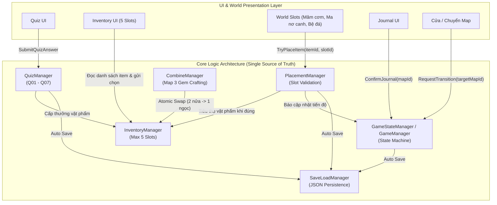

# Kế hoạch Triển khai Kiến trúc CORE LOGIC: Journey of Memories

> **Trạng thái:** nền Core trong tài liệu này đã được triển khai. API hiện hành và quy tắc chia việc phải đọc theo `docs/API_CONTRACT.md` và `GameIds.cs`; không dùng các đoạn “đề xuất” bên dưới để tạo manager thứ hai trong scene.

Tài liệu thiết kế kỹ thuật và kế hoạch thực hiện cho dự án game pixel 2D **Journey of Memories** (Unity 6 / C#) tại `D:\game\GAME-PIXEL`, dựa trên quy chuẩn kiến trúc từ `docs/core_logic_workflow.md` và chi tiết nhiệm vụ từ `docs/Workflow_Logic_Maps_Journey_of_Memories.md`.

---

## 1. Mục tiêu (Goal Description)

Hiện tại, mã nguồn nguyên mẫu (`Assets/Scripts`) đang ghép nối trực tiếp giữa UI và logic màn chơi (ví dụ: `InventoryUI` tự quản lý mảng vật phẩm, `FoodSlot` tự kiểm tra tên món, chưa có hệ thống câu đố văn hóa Q01–Q07, chưa có quản lý trạng thái tập trung và chưa có lưu/tải tiến trình).

Mục tiêu của kế hoạch này là:
1. **Thiết lập Single Source of Truth (Core Logic):** Toàn bộ trạng thái game (trạng thái map, vật phẩm trong túi, câu đố đã giải, slot đã đặt, mini-game hoàn thành) được tập trung vào các Manager độc lập với cảnh và UI.
2. **Tách biệt triệt để UI & Game Logic:** UI chỉ gửi yêu cầu (Event / Action) và lắng nghe cập nhật trạng thái từ Core. UI tuyệt đối không tự sửa dữ liệu hay tự xác nhận hoàn thành.
3. **Thực thi đầy đủ Hợp đồng Giao tiếp Nội bộ (Internal API Contract):**
   - `SubmitQuizAnswer(quizId, optionId)`
   - `TryPlaceItem(itemId, slotId)`
   - `TryCombineGems()`
   - `ConfirmJournal(mapId)`
   - `RequestTransition(targetMapId)`
4. **Hệ thống Lưu/Tải tiến trình (SaveLoadManager):** Tự động lưu tiến trình sau mỗi cột mốc dạng JSON cục bộ, ngăn chặn nhân đôi vật phẩm khi tải lại game.
5. **Cung cấp bộ Unit Test (EditMode):** Kiểm chứng toàn bộ luồng nghiệp vụ không cần chạy game thủ công.



---

## 2. Yêu cầu Người dùng Đánh giá (User Review Required)

> [!IMPORTANT]
> **1. Quy ước Đặt tên ID Dữ liệu (Identifiers):**
> Nhóm phát triển cần thống nhất danh sách ID dùng chung giữa Code, Scene và UI:
> - **Quiz IDs:** `Q01`, `Q02`, `Q03`, `Q04`, `Q05`, `Q06`, `Q07`
> - **Vật phẩm Map 1:** `Food_ThitKhoTrung`, `Food_Kimchi`, `Food_ComCuon`
> - **Slot Map 1:** `Slot_ThitKhoTrung`, `Slot_Kimchi`, `Slot_ComCuon`
> - **Vật phẩm Map 2:** `Clothing_AoDai`, `Clothing_Hanbok`
> - **Slot Map 2:** `Slot_Mother`, `Slot_Father`
> - **Vật phẩm Map 3:** `Gem_LotusHalf`, `Gem_MugunghwaHalf`, `Gem_Whole`, `MapFragment_1`..`MapFragment_4`
> - **Slot Map 3:** `Slot_Pedestal`
> 
> Nếu trong bản mẫu hiện tại bạn muốn giữ tên `FoodItem.FoodName` cũ hay chuyển hoàn toàn sang mã chuẩn trên, xin vui lòng xác nhận. Kế hoạch đề xuất dùng mã chuẩn trên và hỗ trợ adapter tương thích ngược.

> [!WARNING]
> **2. Tương thích ngược với Scene `Level1_Prototype.unity`:**
> Thay vì xóa sạch các script cũ, chúng ta sẽ xây dựng tầng Core mới trong thư mục `Assets/Scripts/Core/`, sau đó tạo Adapter hoặc refactor nhẹ các component cũ (`InventoryUI`, `FoodSlot`, `LevelManager`) để cảnh hiện tại không bị gãy tham chiếu (Missing Script).

---

## 3. Câu hỏi Mở (Open Questions)

> [!NOTE]
> 1. **Dữ liệu Câu đố (Quiz Data Storage):** Bạn muốn lưu 7 câu hỏi văn hóa Q01–Q07 dưới dạng **ScriptableObject** trong Unity (dễ kéo thả chỉnh sửa trong Editor), hay nạp từ file **JSON/C# Code** tích hợp sẵn? *(Đề xuất: Tạo class C# tĩnh mặc định chứa sẵn nội dung Q01–Q07 từ file workflow để chạy được ngay cả trong Unit Test, đồng thời hỗ trợ nạp đè từ ScriptableObject nếu cần).*
> 2. **Vị trí file Save:** Mặc định sẽ ghi vào `Application.persistentDataPath/savegame.json` (tương thích đa nền tảng PC/Android). Bạn có yêu cầu mã hóa dữ liệu lưu không hay để JSON thuần để dễ kiểm tra trong quá trình làm game?

---

## 4. Đề xuất Thay đổi Mã nguồn (Proposed Changes)

### Component 1: Data Contracts & Enums (`Assets/Scripts/Core/Data/`)
Xác định cấu trúc dữ liệu, các Enum và hợp đồng interface cho toàn bộ game.

#### [NEW] `Assets/Scripts/Core/Data/GameEnums.cs`
- `MapId`: `Map1_Kitchen`, `Map2_DressingRoom`, `Map3_Garden`, `Ending`
- `MapState`: `NotStarted`, `Active`, `MemoryPending`, `JournalPending`, `Completed`
- `PlacementResult`: `Success`, `ItemMismatch`, `SlotAlreadyFilled`, `ItemNotInInventory`, `InvalidSlot`
- `QuizOption`: `A`, `B`, `C`, `D`

#### [NEW] `Assets/Scripts/Core/Data/QuizData.cs`
- Chứa cấu trúc câu đố văn hóa: `quizId`, `question`, 4 lựa chọn A-B-C-D, `correctOption`, `feedbackCorrect`, `hintWrong`, `rewardItemId`.
- Bộ dữ liệu sẵn chuẩn hóa 7 câu hỏi Q01–Q07 trích xuất trực tiếp từ Mục 14 trong `docs/Workflow_Logic_Maps_Journey_of_Memories.md`.

#### [NEW] `Assets/Scripts/Core/Data/ItemDatabase.cs`
- Quản lý metadata hiển thị cho vật phẩm (`itemId`, `displayName`, `sprite`, `description`).

---

### Component 2: Core Logic Modules (`Assets/Scripts/Core/Managers/`)

#### [NEW] `Assets/Scripts/Core/Managers/InventoryManager.cs`
- Quản lý túi đồ tối đa 5 ô.
- Độc lập với UI.
- API:
  - `bool AddItem(string itemId)`: Kiểm tra dung lượng < 5, lưu vào list, phát `OnInventoryUpdated`.
  - `bool RemoveItem(string itemId)`: Xóa item, phát `OnInventoryUpdated`.
  - `bool HasItem(string itemId)`
  - `IReadOnlyList<string> Items`
  - `event Action<IReadOnlyList<string>> OnInventoryUpdated`

#### [NEW] `Assets/Scripts/Core/Managers/QuizManager.cs`
- Quản lý 7 câu hỏi văn hóa và trạng thái đã giải.
- API:
  - `QuizResult SubmitQuizAnswer(string quizId, QuizOption option)`: So khớp đáp án. Nếu đúng -> lưu `quiz_solved = true`, tự động cấp `rewardItemId` vào `InventoryManager`, trả về phản hồi tích cực. Nếu sai -> trả về gợi ý sửa lỗi, không phạt tiến độ.
  - `bool IsQuizSolved(string quizId)`
  - `QuizData GetQuiz(string quizId)`
  - `event Action<string, string> OnQuizSolved`

#### [NEW] `Assets/Scripts/Core/Managers/PlacementManager.cs`
- Quản lý việc đặt đồ lên các slot trên map (Mâm cơm, Ma nơ canh, Bệ đá).
- Cấu hình bảng ánh xạ: `slotId -> requiredItemId`.
- API:
  - `PlacementResult TryPlaceItem(string itemId, string slotId)`:
    1. Kiểm tra slot đã có đồ chưa (`SlotAlreadyFilled`).
    2. So khớp `itemId` với `requiredItemId` (`ItemMismatch`).
    3. Nếu đúng: ghi nhận slot hoàn tất, gọi `InventoryManager.RemoveItem(itemId)`, thông báo `GameStateManager.CheckProgress()`, trả về `PlacementResult.Success`.
  - `bool IsSlotFilled(string slotId)`
  - `string GetFilledItem(string slotId)`
  - `event Action<string, string> OnSlotFilled`

#### [NEW] `Assets/Scripts/Core/Managers/CombineManager.cs`
- Xử lý cơ chế ghép ngọc ở Map 3: `Gem_LotusHalf` + `Gem_MugunghwaHalf` -> `Gem_Whole`.
- Thực hiện giao dịch an toàn (atomic swap): chỉ tiêu thụ 2 nửa ngọc khi đã sẵn sàng cấp viên ngọc nguyên vẹn, giải phóng 1 ô túi đồ (2 ô -> 1 ô).

#### [NEW] `Assets/Scripts/Core/Managers/GameStateManager.cs`
- Bộ điều phối trung tâm (Singleton / Persistent Component):
  - Theo dõi `CurrentMapId` và `CurrentMapState` (`NotStarted` -> `Active` -> `MemoryPending` -> `JournalPending` -> `Completed`).
  - Quản lý cờ mini-game: `SetMiniGameDone(int mapIndex, bool done)`.
  - Cổng điều kiện hoàn thành:
    - Map 1: Mèo xong + Q01..Q03 solved + 3 slots mâm cơm filled.
    - Map 2: Lau ảnh xong + Q04..Q05 solved + 2 slots ma nơ canh filled.
    - Map 3: Bản đồ xong + 2 nửa ngọc + ghép ngọc + bệ đá + cầu + gặp Hạ Ân nhỏ.
  - API Hợp đồng:
    - `void ConfirmJournal(MapId mapId)`: Chuyển state sang `Completed`, mở cổng chuyển scene, auto-save.
    - `bool RequestTransition(MapId targetMapId)`: Cho phép chuyển map nếu map hiện tại đã hoàn tất.
  - Events: `OnMapStateChanged`, `OnMemoryTriggered`, `OnJournalReady`, `OnMapCompleted`.

#### [NEW] `Assets/Scripts/Core/Managers/SaveLoadManager.cs`
- Cấu trúc `SaveData` chứa toàn bộ tiến trình: version, map hiện tại, items trong túi, danh sách quiz đã giải, danh sách slot đã đặt, trạng thái mini-game, v.v.
- Tự động lưu khi có thay đổi tiến trình quan trọng.
- Phục hồi an toàn: Cung cấp API `IsItemAlreadyHarvested(itemId)` để các đối tượng ngoài map tự ẩn đi khi game tải lại, tránh nhân đôi đồ vật.

---

### Component 3: Adapters & Refactoring (`Assets/Scripts/Adapters/`)
Tích hợp các thành phần UI và tương tác có sẵn vào Core Logic mà không làm hỏng cấu hình Inspector trong scene `Level1_Prototype.unity`.

#### [MODIFY] `Assets/Scripts/InventoryUI.cs`
- Bỏ việc mảng `inventoryItems` lưu đối tượng game thế giới.
- Lắng nghe `InventoryManager.Instance.OnInventoryUpdated`.
- Khi người chơi bấm chọn ô: Lưu `SelectedItemId` và hiển thị viền vàng.
- Khi cần đặt: Gửi `SelectedItemId` cho tương tác.

#### [MODIFY] `Assets/Scripts/FoodSlot.cs`
- Chuyển thành Adapter kết nối với `PlacementManager`:
  - `slotId = "Slot_ThitKhoTrung"` (cấu hình trong Inspector).
  - Khi đặt: gọi `PlacementManager.Instance.TryPlaceItem(selectedItemId, slotId)`.
  - Khi thành công: hiển thị hình ảnh món ăn trên mâm và kích hoạt hiệu ứng.

#### [MODIFY] `Assets/Scripts/PlayerInteraction.cs`
- Kết nối luồng nhặt/đặt thông qua `InventoryManager` và `PlacementManager`.

#### [MODIFY] `Assets/Scripts/MemorySceneController.cs` & `JournalController.cs`
- Lắng nghe `GameStateManager.Instance.OnMemoryTriggered`.
- Nút "Ghi nhớ" gọi `GameStateManager.Instance.ConfirmJournal(MapId.Map1_Kitchen)`.

#### [NEW] `Assets/Scripts/UI/QuizUIController.cs`
- UI câu đố mở lên khi tương tác vật phẩm:
  - Hiển thị nội dung câu hỏi và 4 nút chọn A, B, C, D.
  - Bấm chọn -> gọi `QuizManager.Instance.SubmitQuizAnswer(quizId, option)`.
  - Hiển thị giải thích đúng/sai -> đóng bảng khi hoàn tất.

---

### Component 4: Bộ Unit Tests (`Assets/Tests/EditMode/CoreLogicTests.cs`)

#### [NEW] `Assets/Tests/EditMode/CoreLogicTests.cs`
- Kiểm thử tự động chạy ngay trong Unity Editor (Test Runner):
  1. `Test_InventoryManager_AddAndRemove_RespectsCapacityLimit5()`
  2. `Test_QuizManager_SubmitAnswer_CorrectAwardsItem_IncorrectDoesNotAward()`
  3. `Test_PlacementManager_CorrectPlacement_ConsumesItemAndFillsSlot()`
  4. `Test_PlacementManager_Mismatch_PreservesItemInInventory()`
  5. `Test_GameStateManager_Map1Conditions_TriggersMemoryPending()`
  6. `Test_CombineManager_GemCrafting_AtomicExchange()`
  7. `Test_SaveLoadManager_SerializationAndRestoration()`

---

## 5. Kế hoạch Kiểm tra & Nghiệm thu (Verification Plan)

### Automated Tests
Chạy bộ kiểm thử tự động Unity Test Runner:
```powershell
# Chạy EditMode Tests thông qua Unity CLI
& "C:\Program Files\Unity\Hub\Editor\6000.6.5f1\Editor\Unity.exe" -runTests -projectPath "D:\game\GAME-PIXEL" -testPlatform EditMode -testResults "D:\game\GAME-PIXEL\Logs\test_results.xml" -batchmode
```
Kiểm tra file `Logs/test_results.xml` để đảm bảo 100% tests Passed.

### Manual Verification
1. **Kiểm tra tương thích Scene:** Mở scene `Level1_Prototype.unity`, ấn Play mode.
2. **Kiểm tra Quiz & Inventory:**
   - Tương tác với nồi thịt kho -> hiện Quiz Q01.
   - Chọn đáp án sai (A/C/D) -> hiện thông báo gợi ý, vật phẩm chưa vào túi.
   - Chọn đáp án đúng (B) -> thông báo thành công, vật phẩm `Food_ThitKhoTrung` xuất hiện trong ô túi đồ thứ nhất.
3. **Kiểm tra Đặt món (Placement):**
   - Chọn `Food_ThitKhoTrung`, thử đặt vào slot Kim chi -> báo sai, món vẫn còn trong túi.
   - Đặt vào đúng slot thịt kho -> món chuyển lên mâm, túi giảm 1 món.
4. **Kiểm tra Tiến trình & Chuyển trạng thái:**
   - Hoàn thành đủ 3 món + vuốt mèo -> Game tự động chuyển trạng thái `MemoryPending`, khóa di chuyển, phát cảnh ký ức mâm cơm.
   - Chuyển sang Nhật ký -> ấn "Ghi nhớ" -> trạng thái chuyển sang `Completed`, cửa mở ra.
5. **Kiểm tra Lưu/Tải (Save/Load):**
   - Đặt 1 món ăn, dừng game, chạy lại -> món vẫn nằm trên mâm, không xuất hiện lại trong nồi và không bị lặp trong túi.
